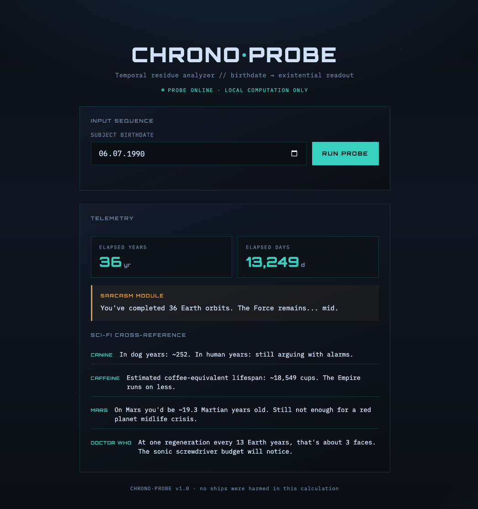

# CHRONO·PROBE

A small sci-fi age calculator built for a **Hacktoberfest** challenge.

Pick a birthdate, hit **Run Probe**, and get elapsed years/days plus a few tongue-in-cheek “telemetry” readouts (dog years, caffeine math, Mars age, Doctor Who regenerations, and a sarcasm module).



## Run it

Open `index.html` in a browser — no build step, no backend. Everything runs locally in the page.

```bash
# optional: serve locally
npx serve .
# or
python3 -m http.server 8000
```

## Stack

Single-file HTML/CSS/JS. Orbitron + IBM Plex Mono for the console look.

## License

[MIT](LICENSE)
